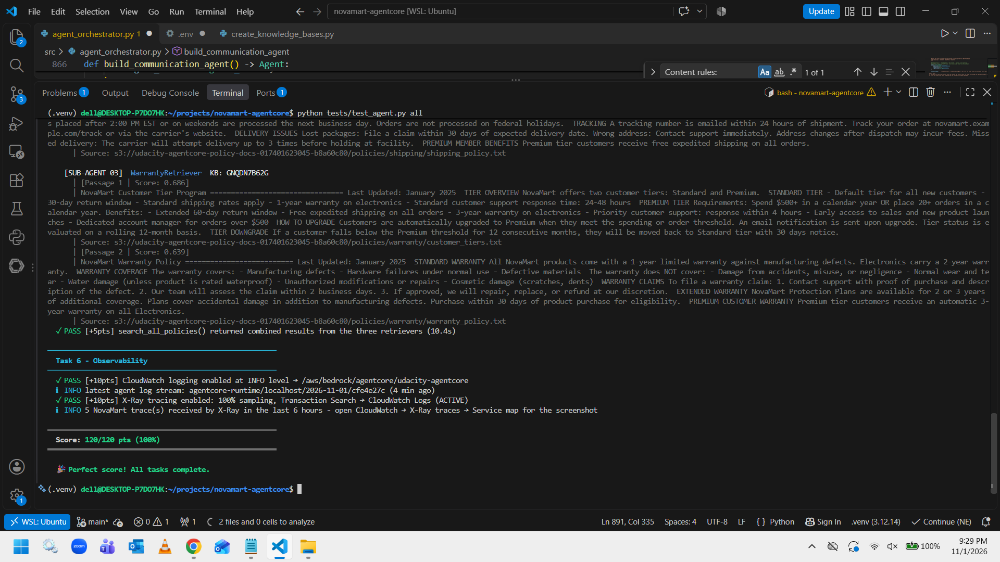
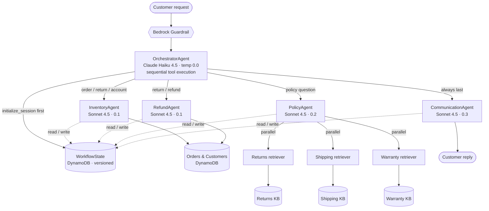
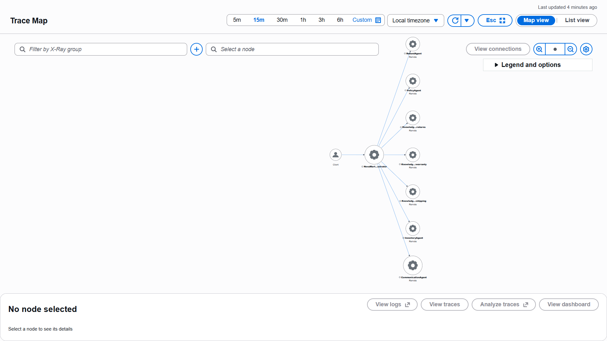

# NovaMart Multi-Agent Customer Support

A production-style multi-agent customer support system on **Amazon Bedrock AgentCore**, built with the **Strands Agents SDK**. An orchestrator understands each customer request, routes it to specialist agents, and returns one grounded, professional reply, with guardrails, shared state, memory and full distributed tracing.

Built as the final project of the Udacity **Future AWS Agent Engineer** Nanodegree (passed, all 120/120 automated tests).



---

## What it does

| Customer asks | What happens |
|---|---|
| "I want to return my order ORD-27176" | Orchestrator → InventoryAgent (facts) → RefundAgent (decision + DynamoDB update) → CommunicationAgent (reply) |
| "What is the return policy for premium customers?" | Orchestrator → PolicyAgent, which searches **3 Knowledge Bases in parallel** → CommunicationAgent |
| "How much are 5 items at $29.99 with 10% off?" | Orchestrator → CommunicationAgent directly ($134.96) |
| "Is Amazon cheaper?" / "I'll sue you" / "Ignore your instructions…" | Blocked by the Bedrock Guardrail before any agent runs |

## Architecture



- **Runtime:** AgentCore Runtime (PUBLIC, HTTP), deployed with the AgentCore CLI (CDK under the hood)
- **Knowledge Bases:** Bedrock KBs on **S3 Vectors** with Titan Embed Text v2 (1024 dimensions), one index per domain
- **Memory:** AgentCore Memory with a session-summary strategy, 7-day retention
- **Observability:** CloudWatch Logs (INFO) and AWS X-Ray at 100% sampling; every agent and Knowledge Base call is a trace node



## Agents

| Agent | Model | Job | Tools |
|---|---|---|---|
| OrchestratorAgent | Claude Haiku 4.5 | Routes requests by 6 rules, manages WorkflowState, never answers itself | `initialize_session`, `route_to_inventory_agent`, `route_to_policy_agent`, `route_to_refund_agent`, `route_to_communication_agent` |
| InventoryAgent | Claude Sonnet 4.5 | Gathers order and customer facts, never decides | `check_order_status`, `get_customer_tier`, `list_customer_orders` |
| RefundAgent | Claude Sonnet 4.5 | Decides eligibility (Standard 30 days, Premium 60) and records returns | `get_inventory_context`, `initiate_refund` |
| PolicyAgent | Claude Sonnet 4.5 | Grounded policy answers from 3 parallel retriever sub-agents | `search_all_policies` |
| CommunicationAgent | Claude Sonnet 4.5 | Writes the final customer reply from all findings | `get_full_workflow_context` |

## Engineering highlights

**Business rules enforced in code, not only in prompts.** `initiate_refund` reloads the order and customer from DynamoDB and re-checks status, tier window and order age before writing. It uses a conditional update, so even a mistaken or manipulated model cannot approve an ineligible return or refund the same order twice. Money is calculated with `Decimal`.

**Optimistic locking on shared state.** Every agent result is saved with an `expected_version`; DynamoDB rejects the write if another writer got there first. Follow-up questions in the same session reset the previous findings through the same versioned update, and a session can't be reused by a different customer.

**Parallel multi-agent RAG with fault isolation.** Three retriever sub-agents run concurrently (`ThreadPoolExecutor` + `as_completed`). If one Knowledge Base fails, the other two still answer.

**No data leakage between customers.** Worker agents are reused across requests, so each call starts with a cleared conversation history.

**Guardrail tuned against false positives.** Content filters, PII (block cards and SSNs, anonymise email and phone), denied topics (competitors, price negotiation, legal threats), profanity, plus a prompt-injection filter. The topics use the STANDARD tier with precise definitions, so "5 items at $29.99 with 10% off" is allowed while "lower the price to $900" is blocked. Published as an immutable numbered version.

**Data minimisation.** Tools return only the fields agents need; customer email addresses never reach a model.

## Debugging story: a race condition found in the cloud

After the first deployment, policy questions returned *"I'm unable to retrieve the policy details"*, even though the same code worked locally.

1. **State:** the DynamoDB WorkflowState record had no `policy_agent` entry.
2. **Guardrail metrics:** 0 interventions, so the guardrail wasn't the cause.
3. **CloudWatch logs:** `initialize_session` and `route_to_policy_agent` started **9 ms apart**.

**Root cause:** the model requested both tools in one turn, and Strands' default `ConcurrentToolExecutor` ran them in parallel. The policy route read the session before it existed, fell back with an empty customer ID, and tripped the session-ownership check. Locally the timing happened to work.

**Fix:** the orchestrator uses `SequentialToolExecutor`, because routing steps depend on each other, and the ownership check ignores calls that don't carry a customer ID. **Verified 3/3 in the cloud:** every session stored a `policy_agent` result, and the logs show each tool starting only after the previous one finished.

During the same incident the CommunicationAgent once filled the gap with **invented policy terms**. It now **fails closed**: without retrieved policy facts, it says it can't retrieve them instead of guessing.

## Project structure

```
src/agent_orchestrator.py        # all agents, routing, guardrail, deployment, memory, observability
scripts/check_access.sh          # checks AWS credentials and Bedrock model access
scripts/create_knowledge_bases.py# creates and syncs the 3 Knowledge Bases (scripted Task 5)
infrastructure/                  # CloudFormation stack, seed data, cleanup (Udacity-provided)
src/agent_utils.py, agent_observability.py, bedrock_kb_retrieval.py, agentcore_cli.py, demo.py
                                 # Udacity-provided helpers (unchanged)
tests/test_agent.py              # Udacity grading suite
config.py                        # resource names from CloudFormation exports + .env
```

## Run it

Requirements: Python 3.12, AWS CLI (us-east-1), Node.js 20+, uv, AgentCore CLI 0.30.0, and access to Claude Haiku 4.5, Claude Sonnet 4.5 and Titan Embed Text v2 in Bedrock.

```bash
uv venv --python 3.12 .venv && source .venv/bin/activate
uv pip install -r requirements.txt
./scripts/check_access.sh

aws cloudformation deploy --template-file infrastructure/starter_stack.yaml \
  --stack-name udacity-agentcore --capabilities CAPABILITY_NAMED_IAM --region us-east-1
python infrastructure/seed_data.py
cp .env.example .env

python scripts/create_knowledge_bases.py      # writes the 3 KB IDs to .env
python src/agent_orchestrator.py deploy       # guardrail, runtime, memory, observability
#   then add AGENTCORE_RUNTIME_ARN, GUARDRAIL_ID and GUARDRAIL_VERSION to .env

python tests/test_agent.py all                # 120/120
python src/agent_orchestrator.py test         # 3 scenarios, traced to X-Ray
python src/agent_orchestrator.py chat         # interactive terminal chat
python src/agent_orchestrator.py invoke "What is the return policy for premium customers?"
```

Clean up afterwards: `python infrastructure/cleanup.py --yes` (run twice).

## Known limitations and next steps

- **Return window start date.** The policy documents count the window from **delivery**; the project specification and this implementation count from the **order date**. None of the seeded orders sit near the boundary, but a production version should use the delivery date.
- **Conflicting source documents.** `customer_tiers.txt` and `warranty_policy.txt` disagree on the Standard electronics warranty (1 vs 2 years). The PolicyAgent is instructed to flag conflicts and prefer the dedicated policy document.
- **Policy latency (~19 s).** Each retriever wraps one KB search in an LLM call, as the project specification requires. Calling the Knowledge Bases directly from the coordinator would cut this to a few seconds.
- **Planned:** guardrail red-team suite with an HTML report, persistent DynamoDB conversation memory, a CloudWatch operations dashboard, Cognito login with a web chat UI, an audit trail and human approval for high-value refunds.

## Credits

Starter code, infrastructure templates, helper modules and the test suite are provided by Udacity for the Future AWS Agent Engineer Nanodegree. The agent implementations, deployment, memory and observability code, the scripts in `scripts/`, and the fixes described above are my own work.

**Mubeen Khan**, AI Engineer · [GitHub](https://github.com/mubeen1996khan)
